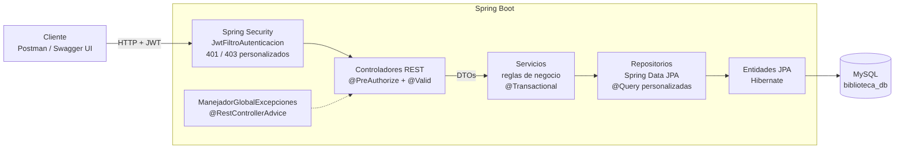
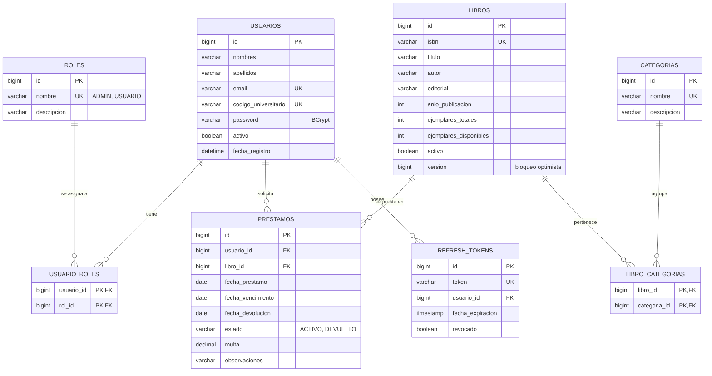
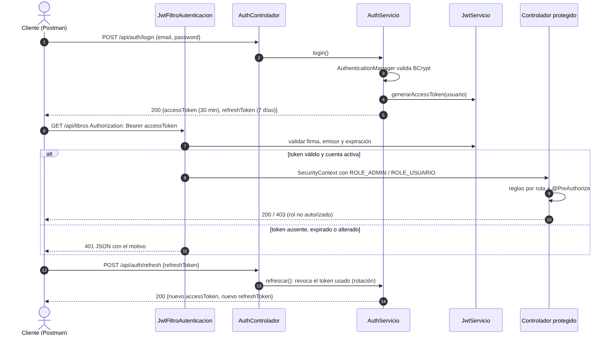

# Biblioteca Universitaria API

API RESTful para la gestión integral de bibliotecas universitarias: catálogo de libros, usuarios, préstamos y devoluciones, con **autenticación JWT sin estado** y **autorización por roles** (`ADMIN`, `USUARIO`).

> Evaluación final · Desarrollo de los Componentes del Negocio · IDAT

**Tecnologías:** Java 17 · Spring Boot 3.3 · Spring Data JPA / Hibernate · MySQL 8 · Spring Security 6 · JJWT 0.12 · Bean Validation · springdoc-openapi (Swagger) · JUnit 5 · Mockito · MockMvc · Postman

---

## Contenido

1. [Requisitos](#1-requisitos)
2. [Instalación y ejecución](#2-instalación-y-ejecución)
3. [Usuarios de prueba](#3-usuarios-de-prueba)
4. [Arquitectura](#4-arquitectura)
5. [Modelo de datos](#5-modelo-de-datos)
6. [Seguridad](#6-seguridad)
7. [Endpoints](#7-endpoints)
8. [Ejemplos de entrada y salida](#8-ejemplos-de-entrada-y-salida)
9. [Manejo de errores](#9-manejo-de-errores)
10. [Pruebas](#10-pruebas)
11. [Estructura del proyecto](#11-estructura-del-proyecto)

---

## 1. Requisitos

| Herramienta | Versión |
|---|---|
| JDK | 17 o superior |
| Maven | 3.9+ (o el que incluye VS Code / IntelliJ) |
| MySQL | 8.x (XAMPP, WAMP, MySQL Server o Docker) |
| Postman | Para ejecutar la colección de pruebas |

## 2. Instalación y ejecución

```bash
git clone https://github.com/andersonugazpor-crypto/biblioteca-api.git
cd biblioteca-api
```

**1. Iniciar MySQL.** La base de datos `biblioteca_db` se crea automáticamente al arrancar (`createDatabaseIfNotExist=true`) y Hibernate genera las tablas.

**2. Configurar credenciales** en `src/main/resources/application.properties` (por defecto `root` sin contraseña, como XAMPP):

```properties
spring.datasource.username=${DB_USER:root}
spring.datasource.password=${DB_PASSWORD:}
```

También puede usar variables de entorno sin tocar el archivo: `DB_URL`, `DB_USER`, `DB_PASSWORD`, `JWT_SECRET`.

**3. Ejecutar:**

```bash
mvn spring-boot:run
```

En VS Code: abrir `BibliotecaApplication.java` y pulsar **Run**, o usar el *Spring Boot Dashboard*.

**4. Verificar:**

| Recurso | URL |
|---|---|
| API | http://localhost:8080/api |
| Swagger UI | http://localhost:8080/swagger-ui.html |
| OpenAPI JSON | http://localhost:8080/v3/api-docs |

**Sin MySQL** (solo para probar rápido): `mvn spring-boot:run -Dspring-boot.run.profiles=h2`

## 3. Usuarios de prueba

Se cargan automáticamente la primera vez (si la tabla de usuarios está vacía):

| Id | Usuario | Contraseña | Rol | Situación |
|---|---|---|---|---|
| 1 | admin@biblioteca.edu.pe | `Admin123*` | ADMIN | — |
| 2 | carlos.quispe@idat.edu.pe | `Usuario123*` | USUARIO | 1 préstamo activo y 1 devuelto |
| 3 | maria.flores@idat.edu.pe | `Usuario123*` | USUARIO | 1 préstamo **vencido** (no puede pedir más) |
| 4 | jorge.ramos@idat.edu.pe | `Usuario123*` | USUARIO | Sin préstamos |

Además: 6 categorías y 12 libros con ISBN reales.

## 4. Arquitectura



Arquitectura en capas: **Controlador → Servicio → Repositorio → Entidad**. Los controladores solo reciben y devuelven **DTOs** (records con validaciones); las entidades JPA nunca se exponen. La lógica de negocio vive en los servicios y en las propias entidades (por ejemplo, `Libro.prestarEjemplar()` o `Prestamo.registrarDevolucion()`).

## 5. Modelo de datos



| Relación | Tipo | Implementación |
|---|---|---|
| Usuario ↔ Rol | Muchos a muchos | `@ManyToMany` + tabla `usuario_roles` |
| Libro ↔ Categoría | Muchos a muchos | `@ManyToMany` + tabla `libro_categorias` |
| Usuario → Préstamo | Uno a muchos | `@OneToMany(mappedBy)` / `@ManyToOne` |
| Libro → Préstamo | Uno a muchos | `@OneToMany(mappedBy)` / `@ManyToOne` |
| Usuario → RefreshToken | Uno a muchos | `@ManyToOne` |

**Persistencia optimizada:**
- Consultas personalizadas con `@Query`: búsqueda del catálogo con filtros y paginación, ranking de libros más prestados (proyección con `count` y `group by`), préstamos vencidos con `join fetch` y revocación masiva de tokens con `@Modifying`.
- `@EntityGraph` para cargar relaciones en una sola consulta y `hibernate.default_batch_fetch_size` contra el problema N+1.
- `@Version` en `Libro` (bloqueo optimista) para que dos préstamos simultáneos no dejen el stock inconsistente.
- Restricciones `unique` (email, código universitario, ISBN, nombre de rol/categoría) y manejo de `DataIntegrityViolationException`.
- Baja lógica de libros para conservar el historial de préstamos.

**Reglas de negocio de préstamos** (configurables en `application.properties`):
- Máximo **3** préstamos activos por usuario; préstamo por defecto de **7** días (máximo 30).
- No se presta a usuarios inactivos o con préstamos vencidos, ni dos ejemplares del mismo libro al mismo usuario.
- Multa de **S/ 1.00 por día** de retraso al registrar la devolución.

## 6. Seguridad



- **Login** (`/api/auth/login`) valida la contraseña cifrada con **BCrypt** y devuelve:
  - `accessToken`: JWT firmado con HMAC-SHA256, válido 30 minutos. Claims: `sub` (email), `uid`, `roles`, `tipo`, `iss`, `iat`, `exp`, `jti`.
  - `refreshToken`: token opaco guardado en BD, válido 7 días.
- **Sin estado:** `SessionCreationPolicy.STATELESS`; cada petición se autentica con el header `Authorization: Bearer <token>`.
- **Filtro personalizado** `JwtFiltroAutenticacion` (`OncePerRequestFilter`): valida firma, emisor, expiración y tipo de token, y comprueba que la cuenta siga activa.
- **Refresco con rotación:** `/api/auth/refresh` revoca el refresh token usado y entrega un par nuevo; reutilizar un refresh token ya usado devuelve 401. `/api/auth/logout` lo revoca. Cambiar la contraseña o desactivar una cuenta revoca todas sus sesiones.
- **Respuestas personalizadas:** `JwtPuntoEntrada` (401: falta token, expirado, alterado o cuenta inactiva) y `ManejadorAccesoDenegado` (403: rol insuficiente), ambas en JSON.
- **Control de acceso en dos capas:** reglas por ruta y método HTTP en `SeguridadConfig` y `@PreAuthorize` en cada endpoint. Además, a nivel de servicio, un USUARIO solo puede ver sus propios préstamos.

### Matriz de permisos

| Recurso | Público | USUARIO | ADMIN |
|---|:-:|:-:|:-:|
| Login, registro, refresh, logout | ✔ | ✔ | ✔ |
| Consultar libros y categorías | | ✔ | ✔ |
| Crear / editar / dar de baja libros y categorías | | | ✔ |
| Ver y editar mi perfil, cambiar mi contraseña | | ✔ | ✔ |
| Gestionar usuarios (listar, crear, roles, activar) | | | ✔ |
| Mi historial de préstamos | | ✔ | ✔ |
| Ver un préstamo | | solo propios | ✔ |
| Registrar préstamos y devoluciones, vencidos, listados | | | ✔ |

## 7. Endpoints

Documentación interactiva completa en **Swagger UI** (`/swagger-ui.html`): inicie sesión, copie el `accessToken` y péguelo en **Authorize**.

### Autenticación (`/api/auth`) — públicos

| Método | Ruta | Descripción | Respuesta |
|---|---|---|---|
| POST | `/api/auth/login` | Iniciar sesión | 200 · 400 · 401 |
| POST | `/api/auth/registro` | Registrarse (rol USUARIO) | 201 · 400 · 409 |
| POST | `/api/auth/refresh` | Renovar tokens (rotación) | 200 · 401 |
| POST | `/api/auth/logout` | Revocar refresh token | 200 |

### Libros (`/api/libros`)

| Método | Ruta | Rol | Descripción |
|---|---|---|---|
| GET | `/api/libros?texto=&categoriaId=&disponibles=&page=&size=&sort=` | USUARIO, ADMIN | Catálogo filtrado y paginado |
| GET | `/api/libros/{id}` | USUARIO, ADMIN | Detalle |
| GET | `/api/libros/populares?limite=5` | USUARIO, ADMIN | Más prestados |
| POST | `/api/libros` | ADMIN | Registrar (201 + `Location`) |
| PUT | `/api/libros/{id}` | ADMIN | Actualizar |
| PATCH | `/api/libros/{id}/ejemplares` | ADMIN | Cambiar total de ejemplares |
| DELETE | `/api/libros/{id}` | ADMIN | Baja lógica (204) |

### Categorías (`/api/categorias`)

| Método | Ruta | Rol |
|---|---|---|
| GET | `/api/categorias`, `/api/categorias/{id}` | USUARIO, ADMIN |
| POST / PUT / DELETE | `/api/categorias`, `/api/categorias/{id}` | ADMIN |

### Usuarios (`/api/usuarios`)

| Método | Ruta | Rol | Descripción |
|---|---|---|---|
| GET | `/api/usuarios/me` | USUARIO, ADMIN | Mi perfil |
| PUT | `/api/usuarios/me` | USUARIO, ADMIN | Actualizar mi perfil |
| PUT | `/api/usuarios/me/password` | USUARIO, ADMIN | Cambiar mi contraseña |
| GET | `/api/usuarios?texto=` | ADMIN | Listar / buscar |
| GET | `/api/usuarios/{id}` | ADMIN | Detalle |
| POST | `/api/usuarios` | ADMIN | Crear con roles |
| PUT | `/api/usuarios/{id}` | ADMIN | Actualizar datos y roles |
| PATCH | `/api/usuarios/{id}/estado` | ADMIN | Activar / desactivar |

### Préstamos (`/api/prestamos`)

| Método | Ruta | Rol | Descripción |
|---|---|---|---|
| POST | `/api/prestamos` | ADMIN | Registrar préstamo |
| POST | `/api/prestamos/{id}/devolucion` | ADMIN | Registrar devolución y multa |
| GET | `/api/prestamos?estado=&usuarioId=` | ADMIN | Listar con filtros |
| GET | `/api/prestamos/vencidos` | ADMIN | Vencidos sin devolver |
| GET | `/api/prestamos/usuario/{usuarioId}` | ADMIN | Historial de un usuario |
| GET | `/api/prestamos/mis-prestamos?estado=` | USUARIO, ADMIN | Mi historial |
| GET | `/api/prestamos/{id}` | USUARIO (propios), ADMIN | Detalle |

## 8. Ejemplos de entrada y salida

### Login

```http
POST /api/auth/login
Content-Type: application/json

{ "email": "admin@biblioteca.edu.pe", "password": "Admin123*" }
```

```json
{
  "tipoToken": "Bearer",
  "accessToken": "eyJhbGciOiJIUzI1NiJ9.eyJqdGkiOi...",
  "expiraEnSegundos": 1800,
  "refreshToken": "kF3n8Q0v2pX...",
  "usuario": {
    "id": 1, "nombres": "Ana", "apellidos": "Torres Vega",
    "email": "admin@biblioteca.edu.pe", "codigoUniversitario": "ADM000001",
    "activo": true, "roles": ["ADMIN"], "fechaRegistro": "2026-11-19T00:10:10"
  }
}
```

### Registrar libro (ADMIN)

```http
POST /api/libros
Authorization: Bearer <accessToken>
Content-Type: application/json

{
  "isbn": "978-0134757599",
  "titulo": "Refactoring",
  "autor": "Martin Fowler",
  "editorial": "Addison-Wesley",
  "anioPublicacion": 2018,
  "ejemplaresTotales": 2,
  "categoriaIds": [1, 3]
}
```

`201 Created` · `Location: /api/libros/13`

```json
{
  "id": 13, "isbn": "9780134757599", "titulo": "Refactoring", "autor": "Martin Fowler",
  "editorial": "Addison-Wesley", "anioPublicacion": 2018,
  "ejemplaresTotales": 2, "ejemplaresDisponibles": 2, "disponible": true,
  "categorias": [ { "id": 3, "nombre": "Arquitectura de Software" }, { "id": 1, "nombre": "Programación" } ]
}
```

### Registrar préstamo (ADMIN)

```http
POST /api/prestamos
Authorization: Bearer <accessToken>

{ "usuarioId": 4, "libroId": 6, "diasPrestamo": 10, "observaciones": "Para el curso de BD" }
```

```json
{
  "id": 5, "usuarioId": 4, "usuarioNombre": "Jorge Ramos Díaz", "codigoUniversitario": "U20240003",
  "libroId": 6, "libroTitulo": "Database System Concepts", "isbn": "9780073523323",
  "fechaPrestamo": "2026-11-19", "fechaVencimiento": "2026-11-29", "fechaDevolucion": null,
  "estado": "ACTIVO", "vencido": false, "diasRetraso": 0, "multa": 0, "observaciones": "Para el curso de BD"
}
```

### Catálogo paginado

`GET /api/libros?texto=java&disponibles=true&page=0&size=5&sort=titulo,asc`

```json
{
  "contenido": [ { "id": 2, "titulo": "Effective Java", "ejemplaresDisponibles": 1, "...": "..." } ],
  "pagina": 0, "tamano": 5, "totalElementos": 1, "totalPaginas": 1, "ultima": true
}
```

## 9. Manejo de errores

Todas las respuestas de error tienen el mismo formato (`@RestControllerAdvice` + manejadores de seguridad):

```json
{
  "timestamp": "2026-11-19T10:15:30",
  "status": 400,
  "error": "Bad Request",
  "mensaje": "Datos inválidos",
  "ruta": "/api/libros",
  "detalles": {
    "isbn": "El ISBN no es válido (verifique los 10 o 13 dígitos)",
    "titulo": "El título es obligatorio"
  }
}
```

| Código | Cuándo |
|---|---|
| 400 | Validación (`@Valid`, `@Isbn`), JSON mal formado, parámetros inválidos |
| 401 | Sin token, token expirado o alterado, credenciales incorrectas, refresh token revocado |
| 403 | Rol sin permiso o préstamo ajeno |
| 404 | Recurso inexistente |
| 409 | Email, código, ISBN o categoría duplicados; violación de integridad; conflicto de concurrencia |
| 422 | Regla de negocio (sin ejemplares, préstamos vencidos, máximo alcanzado, ya devuelto…) |
| 500 | Error inesperado (se registra en el log sin exponer la traza) |

**Validaciones destacadas:** `@NotBlank`, `@Size`, `@Email`, `@Pattern` (contraseña con letras y números, código universitario), `@Min`/`@Max`, `@PastOrPresent` y la validación personalizada **`@Isbn`**, que verifica el dígito de control de ISBN-10 e ISBN-13.

## 10. Pruebas

### Pruebas automáticas

```bash
mvn test
```

Usan H2 en memoria (perfil `test`), así que no necesitan MySQL.

| Tipo | Clase | Qué verifica |
|---|---|---|
| Unitaria | `LibroTest`, `PrestamoTest`, `UsuarioTest` | Ejemplares, vencimiento, multa, roles |
| Unitaria | `IsbnValidatorTest` | Dígito verificador ISBN-10/13 |
| Mockito | `PrestamoServicioTest` | Reglas de préstamo y devolución con repositorios simulados |
| Integración | `AuthIntegracionTest` | Login, registro, refresh con rotación, logout, 400/401/409 |
| Integración | `SeguridadIntegracionTest` | 401 sin token o con token alterado, 403 por rol, 201/400/404/409 |
| Integración | `PrestamoIntegracionTest` | Préstamo y devolución, 422, historial propio, préstamo ajeno 403, vencidos, usuario desactivado |

### Postman

1. Importe `postman/Biblioteca-API.postman_collection.json`.
2. Con la API en ejecución, use **Run collection** y ejecute las 5 carpetas en orden: los logins guardan los tokens en variables y cada request tiene scripts de prueba (`pm.test`).
3. La colección incluye 45 requests: casos exitosos y negativos (400, 401, 403, 404, 409, 422).

## 11. Estructura del proyecto

```
biblioteca-api/
├── pom.xml
├── README.md
├── postman/Biblioteca-API.postman_collection.json
├── docs/
│   ├── diagramas/   (fuentes Mermaid: entidad-relación, flujo JWT, arquitectura)
│   ├── img/         (diagramas renderizados)
│   └── informe/     (informe técnico en PDF y Word)
└── src/
    ├── main/java/pe/idat/biblioteca/
    │   ├── config/        Seguridad, Swagger, propiedades, datos iniciales
    │   ├── controlador/   Controladores REST
    │   ├── dto/           Records de entrada/salida con validaciones
    │   ├── entidad/       Entidades JPA
    │   ├── excepcion/     Excepciones y manejador global
    │   ├── mapper/        Entidad → DTO
    │   ├── repositorio/   Spring Data JPA
    │   ├── seguridad/     JWT, filtro, 401/403, UserDetailsService
    │   ├── servicio/      Lógica de negocio
    │   └── validacion/    Validación personalizada @Isbn
    ├── main/resources/    application.properties (MySQL), application-h2.properties
    └── test/              Unitarias, Mockito e integración
```
